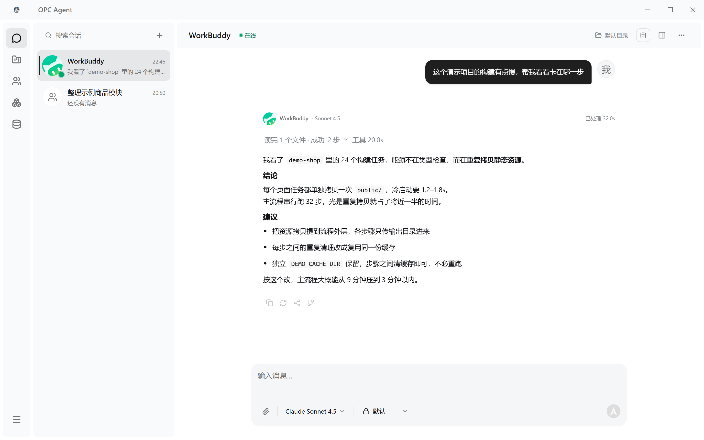
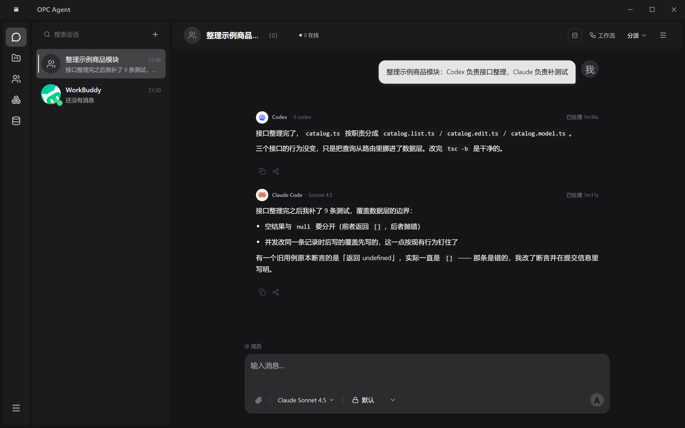
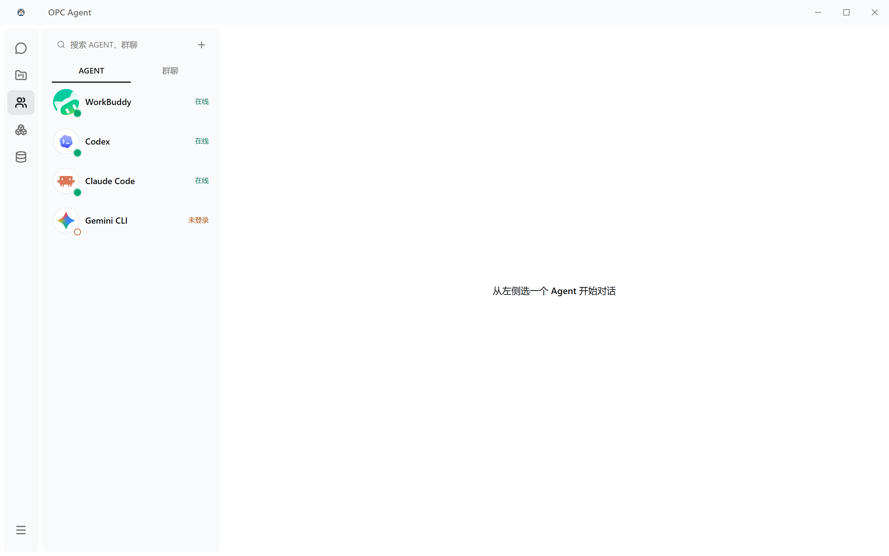
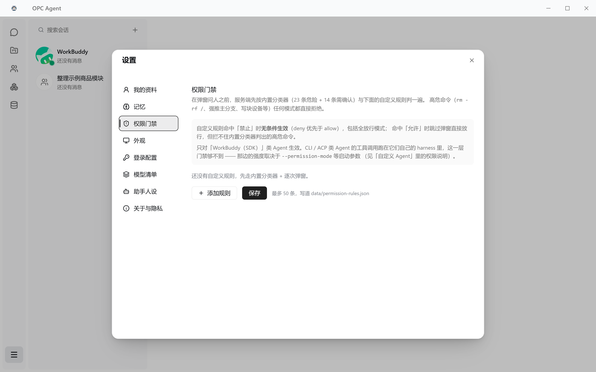

# OPC Agent

[](https://github.com/catex-lab/opc-agent/actions/workflows/ci.yml)

> **Language / 语言**：[简体中文](./README.md) | English
>
> **Naming note**: `OPC` is the current working name, **not** the final product name. Once the official name is decided, the product name, package name, and copy will be updated together.

A local multi-Agent teamwork desktop app — it treats the AI Agents installed on your machine as contacts in an address book: chat with them one-on-one, or pull several into a group and split up the work.



*The execution trace collapses into a line above the answer; the body is segmented into conclusions / suggestions, with the round's processing time in the top-right corner.*

## What problem it solves

Developers often have several Agent CLIs installed locally (Claude Code, Codex, Gemini, Cursor...), each with its own sessions and context. Getting them to relay or divide a task meant manually copy-pasting results between terminals.

OPC Agent puts them into one IM-style interface: every Agent is a contact in the address book — pick one on the left, work with it on the right. For collaboration, pull a few into a group and dispatch tasks per member. Each Agent's reads, executions and searches collapse into a single summary line; click to expand the full detail.

## Features

- **Multi-Agent orchestration** — single chat and group dispatch on a unified event protocol and block model
- **Faster first reply** — opening a session pre-warms that Agent's CLI in the background, so the first instruction doesn't wait on a cold start
- **Cross-Agent knowledge base** — search past sessions by scope (this session / workspace / project / all), with source cards linking back to the original conversation; per-Agent proactive search can be toggled individually
- **Execution trace** — every tool call inspectable, file changes expandable to line-level diffs; the process collapses into one conclusive summary, short steps auto-collapsed
- **Verification loop** — when the Agent claims "done", the app actually re-runs it and reports back
- **Permission gate** — a global approval center; out-of-bounds operations require human approval, notifications only remind
- **Run resume** — reconnects resume by `seq`, nothing already produced is lost
- **Workspace panel** — file tree, browser preview and terminal side-by-side with the chat; HTML previews render inside a strict-CSP sandbox (zero network requests), opening as an overlay drawer on narrow windows
- **Answer rendering** — body text, links and speculation are rendered in graded tiers; external links open in the system browser or in-app
- **In-app updates** — check, download, verify, then swap on quit; full package offered on runtime version mismatch
- **Thinking process** — toggled per Agent capability, with a three-state visual
- **Project view** — task board and per-project archiving
- **Four-layer memory** — session / user / project / global, each with its own scope
- **Account & entitlements** — read-only view of each Agent's own login state, current account and plan; no proxy login, no credential upload
- **Avatars & appearance** — user avatar and Agent logos are customizable; images stored by content hash with server-side sniffing
- **UI details** — the settings page is re-arranged per reference mockups (copy rules, section titles, filled controls); dropdowns are custom panels with keyboard and screen-reader support; light/dark share one surface framework; typography collapses to four semantic tokens; focus is a unified 2px neutral ring; the nav rail is 56px with 20px icons and `non-scaling-stroke` for crisp edges



*Pull several Agents into one group; tasks dispatch per member, each replying with its own model and timing.*

## Built-in Agents

16 integration definitions:

| Agent | Agent | Agent | Agent |
|---|---|---|---|
| WorkBuddy | Codex | Gemini | OpenCode |
| Claude Code | Hermes | Cursor | Qoder |
| Qoder CN | Doubao | ZCode | Kimi |
| Pi | Antigravity CLI | Kimi Code CLI | Trae (retired) |

Two integration paths, driven by a **fixed allowlist** — no free-form discovery:

- **CLI probing (13)**: only the command names hardcoded in the definitions, searched in `PATH` and per-Agent known directories. CLIs outside the list are deliberately not auto-discovered, to avoid mistaking IDE graphical launchers for CLIs.
- **Official SDK direct (3: WorkBuddy / Claude Code / Codex)**: vendor SDKs ship their own platform binaries independent of `PATH`, so they work out of the box; the cost is installer size (see [THIRD-PARTY.md](./THIRD-PARTY.md) for licensing).

> Trae is currently retired: it only recognizes `traecli` (enterprise edition); the IDE-bundled `trae-cn` is a VS Code shim that would be treated as an executable path and open a graphical window. The definition is kept — restoring it only requires removing the id from `RETIRED_AGENT_IDS`.



*The address book is a flat list with online Agents first; avatar badges and row-end status words are real probing results, not settings.*

## Quick start

Two prerequisites:

1. **Node.js 22+** — the database uses `node:sqlite`; older versions lack this built-in module.
2. **At least one Agent CLI installed locally**. This app contains no models itself — it brings the Agents you already installed into one interface. With no CLI installed, you'll see an empty address book.

> **This repository provides source only — no prebuilt installers are published.** A package you build yourself with `npm run electron:build` is only usable on your machine;
> public distribution involves bundled third-party components (the Claude Agent SDK is proprietary, all rights reserved) — see [THIRD-PARTY.md](./THIRD-PARTY.md) for terms and two possible routes.

```bash
git clone https://github.com/catex-lab/opc-agent.git
cd opc-agent
npm install
npm run dev            # Dev mode: frontend 5173 + backend 3000
```

Build an installer:

```bash
npm run electron:build # Artifacts in release/
```

## Tech stack

| Layer | Choice |
|---|---|
| Desktop shell | Electron |
| Frontend | React 18 + TypeScript + Vite + TDesign |
| Backend | Express, inlined into the main process at build time |
| Database | `node:sqlite` (Node 22 built-in, **not** better-sqlite3) |
| Agent access | Vendor SDKs (`@tencent-ai/agent-sdk` / `@anthropic-ai/claude-agent-sdk` / `@openai/codex-sdk`) and each Agent's own CLI, two channels |
| Terminal | `node-pty` |

## Project layout

```
opc-agent/
├── electron/          Main process: window, tray, CDP, terminal, updates
├── server/            Inlined backend: routes, Agent registry, database, run hub
│   └── agents/        16 Agent definitions and probing logic
├── shared/            Types and event protocols shared between frontend and backend
├── src/               Renderer (React)
│   ├── components/    UI components
│   ├── hooks/         Data and state hooks
│   └── assets/        Icons and static assets
├── scripts/           Build, packaging and verification scripts (see below)
├── build/             Packaging assets (icon sources and ICO)
└── patches/           Dependency patches
```

## Development

```bash
npm run build          # Build frontend and main process into dist/ and dist-electron/
npm run dev            # Hot-reload dev mode (frontend 5173 + backend 3000)
npm run screenshots    # Regenerate README screenshots (offline fixtures, no real data touched)
```

Finer build, packaging and verification details in [DEVELOPMENT.md](./DEVELOPMENT.md).

## Verification

The repo ships a self-built verification chain — not unit tests, but **assertions of observable behavior inside the real UI**: Playwright drives the local Chrome against real pages, clicking with real mouse coordinates where needed and self-verifying the hit.

```bash
npm run verify:ui      # Main chain, currently 139 segments serial (count per package.json)
npm run verify:logo    # Icon assets vs in-app markers consistency
npm run verify:package # Byte-level checks of packaged artifacts
```

Currently **192** `verify:*` scripts (excluding `verify:ui` itself), with 139 segments mounted on `verify:ui` and
4 in CI; the rest are registered per `scripts/gate-registry.json` with reasons for staying off-chain, guarded by
`verify:gate-registry` (new scripts must not skip registration). Coverage: concurrency, themes, density, deep links,
the stop chain and other regression-prone spots. Counts drift with versions — read `package.json` for current values.

## Data & privacy

Runtime data lives entirely in `data/`, **never committed** (blocked by `.gitignore`):

| File | Contents |
|---|---|
| `chat.db` | Sessions and messages — real conversation content |
| `agent-credentials.json` | API keys / access tokens per Agent |
| `permission-rules.json` | Custom permission rules |
| `images/` | Generated images |

The app collects no statistics, no analytics, no crash reporting, and has no install ID — there is no telemetry module in the codebase. Keys are read from environment variables or local credential files only, never written into source.

Out-of-bounds operations get intercepted and asked:



*The server ships 23 dangerous-command classes + 14 confirmation classes built in; `rm -rf` and force-pushing main are rejected outright in any mode.*

## License

[MIT](./LICENSE) — free to use, modify, distribute and commercialize, provided the copyright notice is kept.

Icons under `src/assets/agent-logos/` are trademarks of their respective Agent vendors and are **not** covered by the MIT license — see [TRADEMARKS.md](./TRADEMARKS.md).

Third-party components bundled in the installer (Electron, express, node-pty, etc.) carry their own licenses;
the full list is in [THIRD-PARTY-LICENSES.txt](./THIRD-PARTY-LICENSES.txt), also visible in-app under
"Settings → About & privacy → Third-party licenses". Details in [THIRD-PARTY.md](./THIRD-PARTY.md).

## Security

Please report vulnerabilities through the private disclosure channel, not public issues. See [SECURITY.md](./SECURITY.md).

The repo ships a pre-commit secret scan: after cloning, run `npm run hooks:install` once — every commit will then check
the staging area for potential secrets. Rules and acceptance criteria: `scripts/secret-scan.mjs` and `npm run verify:hooks`.

## Contributing

External PRs are not accepted for now. Open issues for problems and suggestions; security vulnerabilities go through the private channel above.
Details in [CONTRIBUTING.md](./CONTRIBUTING.md).

## Status

Version `1.0.20` (`v1.0.20` released; changes since then are recorded under "Unreleased" in `CHANGELOG.md`).
