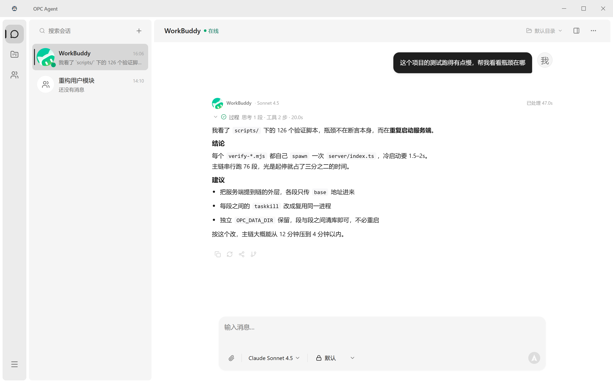
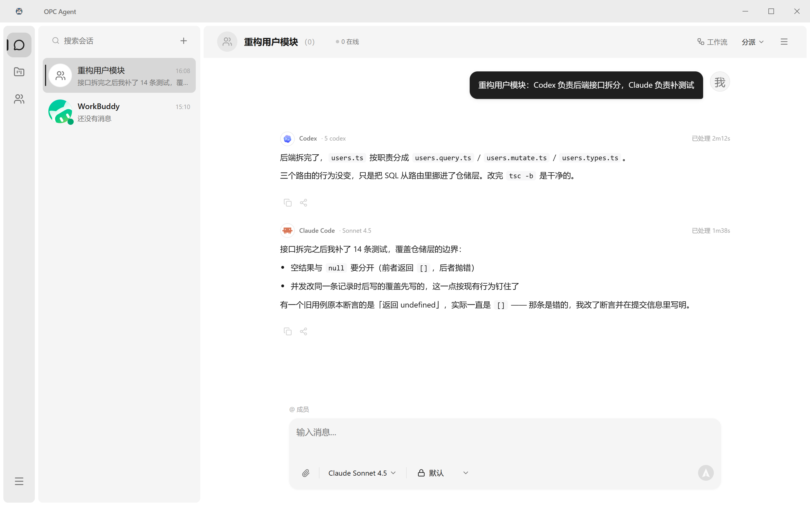
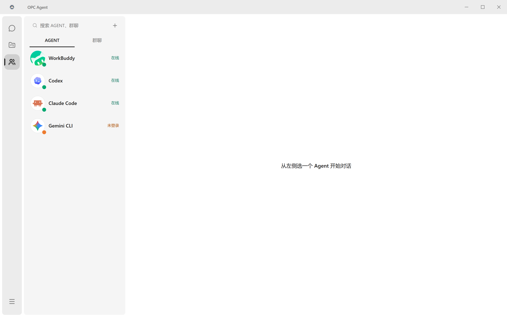
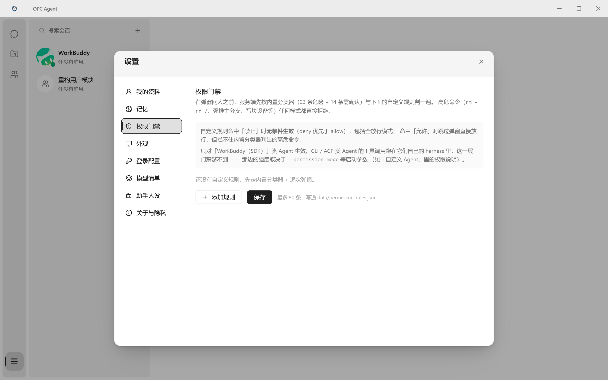

# OPC Agent

> **暂用名说明**：`OPC` 是本项目当前的工作名，**不是正式名称**。正式名称确定后会统一更换，届时仓库中的产品名、包名与文案会一并更新。

本机多 Agent 团队协作桌面应用 —— 把本机安装的各类 Agent 当作通讯录里的联系人，可以单聊，也可以拉群分派任务。



*Agent 的读取、执行、搜索过程折叠成一行「过程」，点开是全部细节；上面是答案正文。*

## 它解决什么问题

本机往往同时装着好几个 Agent CLI（Claude Code、Codex、Gemini、Cursor……），每个都有自己的会话与上下文。想让它们在同一个人物里接力或分工，过去只能手动复制粘贴结果。

OPC Agent 把它们收进一个 IM 界面：通讯录里每个 Agent 是一个联系人，左边选人、右边干活，需要协作时把几个拉进一个群，任务按人分派。Agent 的读取、执行、搜索过程折叠成一行，点开是全部细节。

## 功能

- **多 Agent 编排** —— 单聊与群聊分派，统一事件协议与块模型
- **执行轨迹** —— 工具调用逐条可查，文件改动展开成行级 diff
- **验证闭环** —— Agent 说「完成了」之后，真的去跑一遍再回报
- **权限门** —— 全局审批中心，越权操作必须人工放行，通知只提醒不代替批准
- **运行续传** —— 断线重连按 `seq` 续上，不丢已产出的内容
- **工作区面板** —— 文件树、浏览器预览、终端三个面板，与对话同屏
- **思考过程展示** —— 按 Agent 能力开关，三态视觉区分
- **项目视图** —— 任务面板与项目维度归档
- **四层记忆** —— 会话 / 用户 / 项目 / 全局，各自独立作用域



*把几个 Agent 拉进同一个群，任务按人分派，各自带着自己的模型与耗时回复。*

## 内置 Agent

共 16 条接入定义：

| Agent | Agent | Agent | Agent |
|---|---|---|---|
| WorkBuddy | Codex | Gemini | OpenCode |
| Claude Code | Hermes | Cursor | Qoder |
| Qoder CN | 豆包 | ZCode | Kimi |
| Pi | Antigravity CLI | Kimi Code CLI | Trae（暂时下架） |

探测方式是**白名单**：只认这 16 条定义里写死的命令名，在 `PATH` 与各自约定目录里查找可执行文件。名单外的 CLI 即使装了也不会被自动发现 —— 这是刻意的，避免把 IDE 的图形启动器误判成 CLI。

> Trae 目前下架：只认 `traecli`（企业版），IDE 自带的 `trae-cn` 是 VS Code 垫片，接进去会被当成可执行路径、拉起图形窗口。定义保留，恢复只需从 `RETIRED_AGENT_IDS` 里删掉 id。



*通讯录按「在线 / 待处理」分组，状态点是探测出来的真实结果，不是配置项。*

## 快速开始

两个前提：

1. **Node.js 22+** —— 数据库用的是 `node:sqlite`，低版本没有这个内置模块。
2. **本机至少装一个 Agent CLI**。这个应用本身不含任何模型，它只是把你自己装好的 Agent 收进一个界面。一个 CLI 都没装的话，打开会是空通讯录。

```bash
git clone https://github.com/catex-lab/opc-agent.git
cd opc-agent
npm install
npm run dev            # 开发态：前端 5173 + 后端 3000
```

打包成安装程序：

```bash
npm run electron:build # 产物在 release/
```

## 技术栈

| 层 | 选型 |
|---|---|
| 桌面壳 | Electron |
| 前端 | React 18 + TypeScript + Vite + TDesign |
| 后端 | Express，构建时内联进主进程 |
| 数据库 | `node:sqlite`（Node 22 内置模块，**不是** better-sqlite3） |
| Agent 接入 | `@tencent-ai/agent-sdk`、`@qoder-ai/qoder-agent-sdk` 等 |
| 终端 | `node-pty` |

## 目录结构

```
opc-agent/
├── electron/          主进程：窗口、托盘、CDP、终端、更新
├── server/            内联后端：路由、Agent 注册表、数据库、运行中枢
│   └── agents/        16 条 Agent 定义与探测逻辑
├── shared/            前后端共用的类型与事件协议
├── src/               渲染进程（React）
│   ├── components/    界面组件
│   ├── hooks/         数据与状态钩子
│   └── assets/        图标等静态资源
├── scripts/           构建、打包与验证脚本（见下）
├── build/             打包资源（图标源图与 ICO）
└── patches/           依赖补丁
```

## 开发

```bash
npm run build          # 构建前端与主进程，产物在 dist/ 与 dist-electron/
npm run dev            # 热重载开发态（同时起前端 5173 与后端 3000）
npm run screenshots    # 重新生成 README 里的截图（离线夹具，不碰真实数据）
```

更细的构建、打包与验证说明见 [DEVELOPMENT.md](./DEVELOPMENT.md)。

## 验证

仓库里有一套自建的验证链，不是单元测试，而是**在真实界面里断言可观测行为**：用 Playwright 驱动本机 Chrome 打开真实页面，必要时用真实鼠标坐标点击并自证命中。

```bash
npm run verify:ui      # 主链，70+ 段串行
npm run verify:logo    # 图标资产与界面标记的一致性
npm run verify:package # 打包产物逐字节核对
```

共 100+ 条 `verify:*` 脚本，覆盖并发、主题、密度、深链、停止链路等易回归点。改动前先看 `package.json` 里的实际条数。

## 数据与隐私

运行时数据全部落在 `data/` 目录，**不进版本库**（`.gitignore` 已挡）：

| 文件 | 内容 |
|---|---|
| `chat.db` | 会话与消息，真实对话内容 |
| `agent-credentials.json` | 各 Agent 的 API Key / 访问令牌 |
| `permission-rules.json` | 自定义权限规则 |
| `images/` | 生成的图片 |

应用内不收集统计、不埋点、不做崩溃上报，也没有安装 ID —— 代码里不存在遥测模块。密钥一律从环境变量或本地凭据文件读取，不写进源码。

越权的操作会被拦下来问你：



*服务端内置 23 类危险命令 + 14 条需确认，`rm -rf`、强推主分支这类直接拒绝，任何模式都放不过去。*

## 许可

[MIT](./LICENSE) —— 可自由使用、修改、分发、商用，保留版权声明即可。

`src/assets/agent-logos/` 下的图标是各 Agent 厂商的商标，**不在 MIT 范围内**，
详见 [TRADEMARKS.md](./TRADEMARKS.md)。

安装包里打进去的第三方组件（Electron、express、node-pty 等）各自适用自己的许可，
完整清单见 [THIRD-PARTY-LICENSES.txt](./THIRD-PARTY-LICENSES.txt)，
应用内「设置 → 关于与隐私 → 第三方许可」也能看到主要组件。说明见 [THIRD-PARTY.md](./THIRD-PARTY.md)。

## 安全

漏洞请走私密报告通道，不要开公开 issue。详见 [SECURITY.md](./SECURITY.md)。

仓库自带提交前密钥扫描：clone 后跑一次 `npm run hooks:install`，之后每次提交都会检查
暂存区里有没有疑似密钥。规则与验收见 `scripts/secret-scan.mjs` 与 `npm run verify:hooks`。

## 参与

本仓库暂不接收外部 PR。问题与建议请开 issue，安全漏洞走上面的私密通道，
具体说明见 [CONTRIBUTING.md](./CONTRIBUTING.md)。

## 状态

版本 `1.0.0`。
